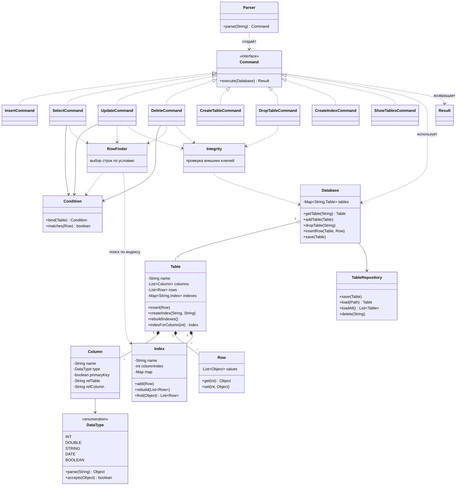
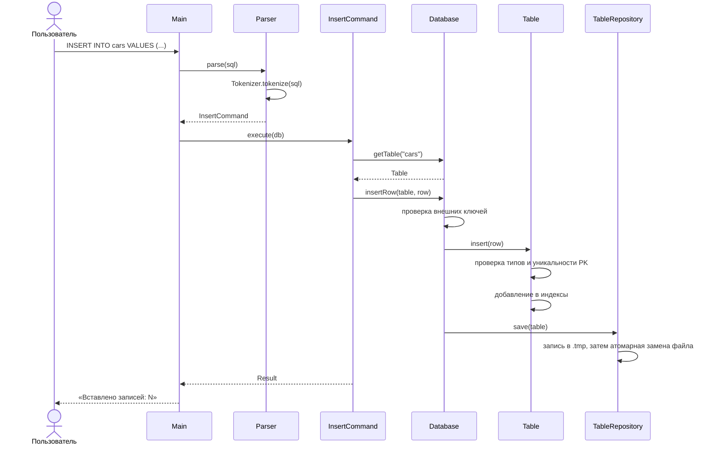

# Лабораторная работа №2. Упрощённая СУБД на Java

Мини-СУБД с консольным интерфейсом и SQL-подобным языком запросов. Данные хранятся в файлах на диске и загружаются при запуске, поддерживаются связи между таблицами и индексы.

**Авторы:** Лепенькин Кирилл, Дудин Максим
**Язык:** Java 8+ (разработка и тесты на JDK 27), внешних библиотек нет.

## Возможности

- Таблицы с типами `INT`, `DOUBLE`, `STRING`, `DATE`, `BOOLEAN`, первичный ключ, внешний ключ (`REFERENCES`).
- `INSERT` (одна или несколько строк, с указанием столбцов и без), `SELECT`, `UPDATE`, `DELETE` с одним условием `WHERE`.
- `CREATE TABLE`, `DROP TABLE`, `SHOW TABLES`.
- `CREATE INDEX` и ускорение `SELECT ... WHERE col = значение` по индексированному столбцу.
- Проверка уникальности первичного ключа и существования записи, на которую ссылается внешний ключ.
- Сохранение на диск после каждой изменяющей команды, загрузка таблиц и индексов при старте.

## Инструкция пользователя

### Сборка и запуск

Из корня проекта (там, где лежит папка `src`).

macOS / Linux:

```bash
mkdir -p out
javac -encoding UTF-8 -d out $(find src -name "*.java")
java -Dfile.encoding=UTF-8 -cp out dbms.Main
```

Windows (PowerShell):

```powershell
mkdir out -Force
javac -encoding UTF-8 -d out (Get-ChildItem -Recurse src -Filter *.java).FullName
java -Dfile.encoding=UTF-8 -cp out dbms.Main
```

Можно запустить и из IntelliJ IDEA: открыть проект и запустить `dbms.Main`.

Данные хранятся в папке `data/` рядом с местом запуска. Другую папку можно передать аргументом: `java -cp out dbms.Main mydata`.

### Работа в консоли

Команда заканчивается `;` и может занимать несколько строк. `help` выводит справку, `exit` завершает работу.

```sql
CREATE TABLE cars (id INT PRIMARY KEY, brand STRING, price DOUBLE, available BOOLEAN);
CREATE TABLE sales (id INT PRIMARY KEY, car_id INT REFERENCES cars(id), sold DATE, buyer STRING);
SHOW TABLES;

INSERT INTO cars VALUES (1, 'Toyota', 25000.0, TRUE);
INSERT INTO cars (id, brand) VALUES (2, 'BMW');
INSERT INTO cars VALUES (3, 'Audi', 18000.5, FALSE), (4, 'Kia', 15000, TRUE);
INSERT INTO sales VALUES (1, 3, '2026-11-10', 'Ivan');

SELECT * FROM cars;
SELECT brand, price FROM cars WHERE price > 20000;
UPDATE cars SET price = 30000 WHERE id = 2;
DELETE FROM cars WHERE brand = 'Toyota';

CREATE INDEX idx_cars_brand ON cars (brand);
SELECT * FROM cars WHERE brand = 'Audi';   -- использует индекс
DROP TABLE sales;
```

Операторы в `WHERE`: `=`, `!=` (или `<>`), `<`, `>`, `<=`, `>=`. Дата записывается в кавычках: `'2026-11-10'`. Незаполненные значения хранятся как `NULL`.

Ошибки (дубликат ключа, неверный тип, несуществующая таблица или ссылка, синтаксис) выводятся сообщением, программа продолжает работать.

### Автоматические тесты и бенчмарк

```bash
java -cp out dbms.AutoTests    # проверка всех операций, сохранения на диск и индексов
java -cp out dbms.Benchmark    # замеры скорости с индексом и без
```

`AutoTests` работает во временной папке и не трогает `data/`. Итог выводится строкой «Пройдено: N, провалено: M».

## Архитектура

Запрос проходит по цепочке: ввод → токенизатор → парсер → команда → база данных → файл на диске.

| Пакет | Назначение |
|-------|-----------|
| `dbms.model` | `DataType`, `Column`, `Row`, `Table`: данные, проверка типов и уникальности ключа |
| `dbms.index` | `Index`: индекс «значение → строки» на `HashMap` |
| `dbms.storage` | `Database` (набор таблиц, проверка внешних ключей), `TableRepository` (запись и чтение файлов) |
| `dbms.parser` | `Tokenizer`, `Token`, `TokenType`, `Parser`, `Condition`: разбор SQL-подобного языка |
| `dbms.command` | `Command` и его реализации (`InsertCommand`, `SelectCommand`, `UpdateCommand`, `DeleteCommand`, `CreateTableCommand`, `DropTableCommand`, `CreateIndexCommand`, `ShowTablesCommand`), `Result`; вспомогательные классы `RowFinder` (выбор строк по условию, с использованием индекса) и `Integrity` (проверка внешних ключей при `UPDATE`, `DELETE`, `DROP TABLE`) |
| `dbms.util` | `TablePrinter`: вывод результата таблицей |
| `dbms` | `Main` (консоль), `AutoTests`, `Benchmark`, `ModelDemo` |

Применённые паттерны: **Command** (каждый запрос это объект с методом `execute(Database)`), **Repository** (`TableRepository` скрывает работу с файлами), **Facade** (`Database` единая точка доступа к таблицам).

### Диаграмма классов



### Диаграмма последовательностей: `INSERT`



### Хранение данных

- Используется стандартная Java-сериализация (`Serializable`, `ObjectOutputStream`). Одна таблица это один файл `data/<имя>.tbl`.
- Индексы хранятся внутри объекта `Table`, поэтому записываются в тот же файл: данные и индекс не могут разойтись. При старте индекс восстанавливается вместе с таблицей.
- **Надёжность:** таблица сначала пишется во временный файл `.tmp`, затем подменяет основной через `Files.move(..., ATOMIC_MOVE)`. Если программа упадёт во время записи, прежний файл останется целым. Сохранение выполняется после каждой изменяющей команды, поэтому при аварийном завершении теряется не более команды, выполнявшейся в момент сбоя.


## Тестирование производительности

Условия: таблица `cars(id, brand, price)`, 10 000 уникальных значений `brand`, поиск `brand = '...'`. Среднее время одного запроса: без индекса по 200 запросам, с индексом по 20 000 запросов, после прогрева JVM. Замер в памяти (без разбора SQL и дискового ввода-вывода), код в `dbms.Benchmark`. Платформа: macOS, JDK 27.

| Строк     | Построение индекса, мс | Без индекса, мкс | С индексом, мкс | Ускорение |
|-----------|------------------------|------------------|-----------------|-----------|
| 10 000    | 4,0                    | 58,39            | 0,111           | ~526×     |
| 100 000   | 7,3                    | 382,57           | 0,077           | ~4 957×   |
| 1 000 000 | 23,7                   | 2 982,90         | 0,034           | ~88 061×  |

Без индекса время растёт линейно с размером таблицы, O(n). С индексом оно почти не зависит от размера, O(1), поэтому выигрыш растёт вместе с объёмом данных. Небольшие колебания времени с индексом (0,03–0,11 мкс) лежат в пределах погрешности измерения.

## Тестирование функциональности

Класс `dbms.AutoTests` выполняет SQL-запросы через тот же `Parser` и `Command`, что и консоль, на временной базе и проверяет результат кодом. Покрыто: создание и удаление таблиц, вставка (в том числе нескольких строк и неполных), дубликат первичного ключа, неверные типы и число значений, внешний ключ, `SELECT` с условиями, `UPDATE`, `DELETE`, актуальность индекса после `INSERT`/`UPDATE`/`DELETE`, перезапуск базы (данные и индекс загружаются с диска) и отсутствие временных файлов.

Результат последнего запуска: Пройдено: 34, провалено: 0.

## Области ответственности

| Участник | Задачи |
|----------|--------|
| **Лепенькин Кирилл** | модель данных (`model`), хранение и сериализация (`storage`), внешние ключи, индексы (`index`), бенчмарк, автотесты, разделы README про хранение, индексы и производительность |
| **Дудин Максим** | токенизатор, парсер и условия (`parser`), команды (`command`), консольный интерфейс и вывод таблицей (`Main`, `util`), раздел README с инструкцией пользователя, выбор строк с использованием индекса при SELECT (RowFinder), проверка внешних ключей при UPDATE/DELETE/DROP TABLE |

Диаграммы, выводы и Javadoc: каждый участник документировал свои классы.

## Выводы

Реализована СУБД, удовлетворяющая требованиям задания: пять типов данных, две и более связанные таблицы, вставка, обновление, удаление и выборка по SQL-подобным запросам, хранение на диске с восстановлением при запуске, индексы с сохранением и ускорением `SELECT`. Эксперимент показал, что индекс даёт ускорение поиска на 2–5 порядков, причём выигрыш растёт с размером таблицы.


## Список использованных источников

1. Oracle. Java SE Documentation: `java.io.Serializable`, `ObjectOutputStream`, `java.nio.file.Files`. https://docs.oracle.com/en/java/javase/
2. Oracle. The Java Tutorials: Collections, Java I/O. https://docs.oracle.com/javase/tutorial/
3. Gamma E., Helm R., Johnson R., Vlissides J. Design Patterns: Elements of Reusable Object-Oriented Software (паттерны Command, Repository/Facade).
4. Garcia-Molina H., Ullman J., Widom J. Database Systems: The Complete Book (индексы, хранение данных).
5. Документация Mermaid (диаграммы в Markdown). https://mermaid.js.org/

